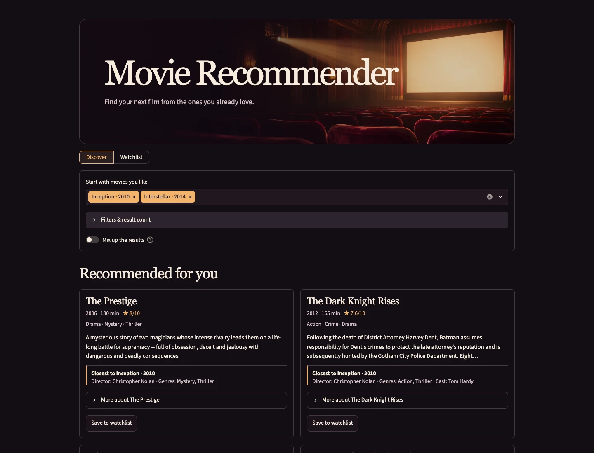

# Movie Recommender

[](https://github.com/prathamkashyap/movie-recommender/actions/workflows/ci.yml)
[](#run-locally)

Find films similar to up to three titles you like. The Streamlit app builds a content-based index from the bundled TMDB snapshot of **4,803 films**, with recommendations, filters, and a watchlist available offline.

[Open the Streamlit app](https://free-movie-recommender.streamlit.app/). If it has gone to sleep, select **Yes, get this app back up!**



## What you can do

- Search by title and release year, or try **Inception + Interstellar**. The URL records your selected films so you can share that starting point.
- Filter by genre, release year, and minimum TMDB votes. Turn on **Mix up the results** to reduce repetition in the recommendations.
- See what each film has in common with its closest starting title. Open the film’s details for the full synopsis, director, cast, and vote count.
- Browse vote-adjusted top-rated films with an empty search. Save films to a session watchlist and download it as a UTF-8 CSV.

## Run locally

From the repository root with Python 3.11–3.13:

```sh
python -m venv .venv
source .venv/bin/activate
python -m pip install -r requirements.txt
python -m streamlit run app.py
```

On Windows PowerShell, activate with `.venv\Scripts\Activate.ps1`. The app prints its local URL when it starts.

### Optional TMDB posters

Set `TMDB_READ_ACCESS_TOKEN` as an environment variable, or copy [the example secrets file](.streamlit/secrets.toml.example) to `.streamlit/secrets.toml` and enter your [TMDB API Read Access Token](https://developer.themoviedb.org/docs/getting-started). For Streamlit Community Cloud, choose `app.py` as the entry point and add the same key in the app’s Secrets settings.

Poster lookups are cached for 30 minutes and use short network timeouts. The movie cards show the local catalog details when a poster is unavailable.

## How ranking works

The app joins movies and credits by numeric TMDB ID, which keeps films with the same title distinct. It builds and caches one sparse TF-IDF feature matrix from the two CSVs at startup.

| Field | Weight |
| --- | ---: |
| Overview words and two-word phrases | 32% |
| TMDB keywords | 30% |
| Genres | 18% |
| Directors | 12% |
| First five cast credits | 8% |

Each field contributes a weighted cosine similarity. Missing fields contribute zero and each selected film contributes equally. The recommender excludes the selected films and candidates with no feature overlap. Explanations describe shared metadata with the closest selected film, or shared plot language when that is the only signal.

**Mix up the results** subtracts a similarity penalty based on the most similar film already in the list. **Top rated** uses a 100-vote prior that pulls films with few votes toward the catalog’s vote-weighted average rating.

The snapshot spans 1916–2017 and its ratings reflect that snapshot. Rankings use the bundled metadata and vote counts. The [original notebook](movie-recommender-system.ipynb) documents the earlier prototype.

## Development

```sh
python -m pip install -r requirements-dev.txt
ruff check .
ruff format --check .
python -m pytest
```

GitHub Actions runs these checks on Python 3.11, 3.12, and 3.13. Tests cover ranking, duplicate titles, filtering, share URLs, watchlist behavior, and missing or invalid poster responses.

## Data and credits

Film metadata and ratings come from the [TMDB 5000 Movie Dataset on Kaggle](https://www.kaggle.com/datasets/tmdb/tmdb-movie-metadata). See the dataset description and [TMDB’s terms](https://www.themoviedb.org/documentation/api/terms-of-use) for reuse. This product uses the TMDB API but is not endorsed or certified by TMDB. [TMDB logo and attribution guidance](https://developer.themoviedb.org/docs/faq).

Project code and documentation are released under the [MIT License](LICENSE). The dataset and TMDB branding and images retain their respective terms.

<details>
<summary>Header artwork and generation prompt</summary>

The cinema header was generated with OpenAI’s built-in ImageGen tool and saved as [cinema.webp](static/cinema.webp).

> Use case: photorealistic-natural. Asset type: wide background image for an independent movie discovery app. A cinematic still photographed from the back of a quiet vintage movie theater with deep burgundy velvet seats and a hazy warm amber beam shooting diagonally through the room toward a bright blank screen on the right. Rich near-black plum shadows, subtle film grain, lens bloom, moody editorial color grade, premium repertory-cinema aesthetic. Concentrate recognizable detail and light in the right half and keep the left half dark and low-contrast for an HTML heading. Compose in wide landscape, useful when cropped to a 4:1 center strip. No people, no text, no lettering, no logos, no border.

</details>
